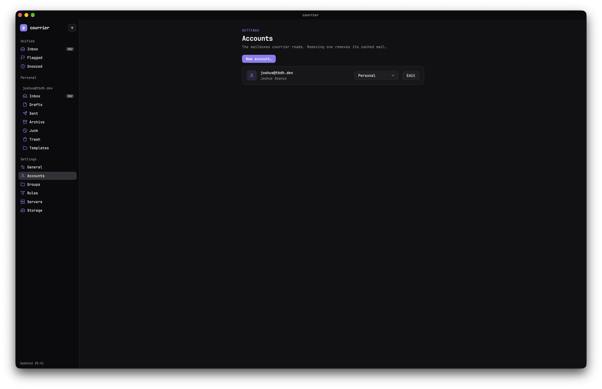
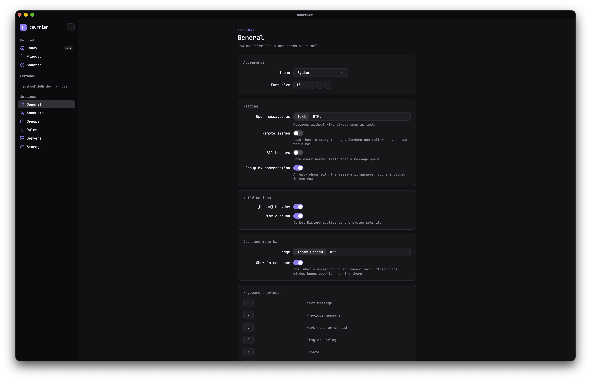

# courrier

[](https://github.com/tbdsux/courrier/actions/workflows/ci.yml)

A fast, keyboard-friendly desktop mail client for macOS, Windows and Linux.
It is written in Go with [MyGo](https://mygo.egoist.dev)'s native UI: no
Electron, no bundled browser. The only web view is the system's own, used to
show HTML mail in a sandbox (no scripts, no remote images unless you allow them).





## Features

- **Any account**: IMAP or POP3 for incoming mail, SMTP for outgoing, with
  SSL/TLS, STARTTLS or none. Presets for Gmail and Outlook, and
  "Sign in with Google / Microsoft" (OAuth2) when the build has client IDs.
- **Three panes**: folders, message list, message. A unified inbox and a
  flagged view across all accounts. HTML mail and attachments.
- **Works offline**: mail is cached locally. Read, flag, archive, delete and
  move without a connection; actions and sent mail go out once you're back
  online. Drafts survive a crash or a quit.
- **Conversations**: replies grouped into one thread, your own included.
- **Search**: instant local search, and server search for older mail.
- **Rules, snooze and send later**: sort new mail automatically, snooze a
  message until a time you pick, schedule a send, templates and saved searches.
- **Identities and signatures**: send as any of your addresses, each with its
  own name and signature.
- **In the background**: new-mail notifications, unread count on the
  Dock/taskbar and in the menu bar, start at login, default `mailto:` handler.
- **Big mailboxes**: CONDSTORE/QRESYNC sync, a cache size you choose
  (Settings → Storage), and export to mbox.
- **Auto-updates** from GitHub releases, signed.

### Keyboard shortcuts

| Key | Action | Key | Action |
|---|---|---|---|
| `J` / `K` | Next / previous message | `R` | Reply |
| `U` | Mark read / unread | `A` | Reply all |
| `S` | Flag / unflag | `F` | Forward |
| `E` | Archive | `Z` | Snooze |
| `#`, `Delete`, `⌫` | Delete | `V` | Move to… |
| `⌘N` / `Ctrl+N` | New message | `⌘F` / `Ctrl+F` | Search |

## Install

Download the latest build for your system from the
[Releases](https://github.com/tbdsux/courrier/releases) page:

| System | File |
|---|---|
| macOS | `courrier <version> <arch>.dmg` (arm64 for Apple silicon): open it and drag courrier to Applications |
| Windows | `courrier Setup <version> <arch>.exe`: run the installer |
| Linux (Debian/Ubuntu) | `courrier_<version>_<arch>.deb`: `sudo apt install ./courrier_*.deb` |
| Linux (other) | `courrier-<version>-linux-<arch>.tar.gz`: `sh install.sh courrier-*.tar.gz` |

> **macOS builds are not signed or notarized yet.** macOS will say courrier
> "can't be opened". To run it anyway: try to open it once, then go to
> System Settings → Privacy & Security and click **Open Anyway**, or run
> `xattr -dr com.apple.quarantine /Applications/courrier.app`. Because the
> build is unsigned, macOS may also ask again for Keychain access after each update.

HTML mail uses the system web view: on Linux that is WebKitGTK 4.1
(`sudo apt install libwebkit2gtk-4.1-0`, which the `.deb` pulls in), on
Windows 10 the [WebView2 Runtime](https://developer.microsoft.com/microsoft-edge/webview2/)
(Windows 11 has it). macOS needs nothing.

Installed copies update themselves: menu **Check for Updates…**, or
Settings → General → Updates.

Your passwords never sit in plain text: they are sealed in the local
database with a key kept in the system's credential store (Keychain on
macOS, Credential Manager on Windows, Secret Service on Linux). The first
launch may ask once to allow courrier to use it.

## Build from source

You need [Go](https://go.dev/dl/) 1.27.3 or later. Nothing else: no cgo and no
C toolchain (Linux and Windows 10 need the web view above to *run* it). The MyGo CLI is pinned in `go.mod` as a
Go tool, so `go tool mygo` runs the right version.

```sh
git clone https://github.com/tbdsux/courrier.git
cd courrier

go tool mygo dev        # run it, rebuilding as the code changes
go tool mygo build      # a production build for this machine, in build/<os>-<arch>/
```

Cross-compile from any machine:

```sh
go tool mygo build -platform darwin/universal,windows/amd64,linux/amd64
```

Windows installers need [NSIS](https://nsis.sourceforge.io) (`makensis`);
without it the build skips the installer and still writes `courrier.exe`.

### Tests

```sh
CGO_ENABLED=0 go test ./...
go tool mygo vet .
```

### Google and Microsoft sign-in

These need OAuth client IDs, linked in at build time. A build without them
hides the "Sign in with…" buttons and keeps the app-password path, so a
plain source build works fine with password accounts.

```sh
go build -ldflags "-X courrier/mail.GoogleClientID=… -X courrier/mail.GoogleClientSecret=… -X courrier/mail.MicrosoftClientID=…" .
```

To register the clients:

- Google: a *Desktop app* OAuth client with the `https://mail.google.com/`
  scope. Its "secret" isn't one (any user can read it from the app), but
  Google's token endpoint asks for it. The scope is restricted: until
  Google verifies the app, it works for up to 100 test users.
- Microsoft: an Entra app registration, *Mobile and desktop applications*
  platform with the redirect URI `http://localhost`, "Allow public client
  flows" on, and the delegated permissions `IMAP.AccessAsUser.All`,
  `SMTP.Send` and `offline_access` (Office 365 Exchange Online). Tenant `common`.

## How it works

- [docs/how-it-works.md](docs/how-it-works.md): the architecture, the
  packages, how sync, the offline action queue and the outbox fit together,
  the database, and where data is stored.
- [docs/design.md](docs/design.md): the design system: layout, typography,
  the color tokens of every theme, spacing, icons and interaction specs.

## License

[MIT](LICENSE). The bundled JetBrains Mono fonts are under the
[SIL Open Font License 1.1](fonts/OFL.txt).
